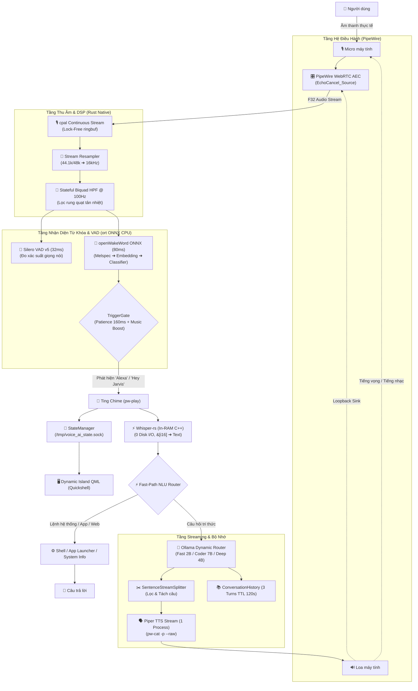

# Voice AI - Native Rust Engine 🦀⚡ (v3.0)

Hệ thống Trợ lý ảo AI cục bộ siêu tốc độ (Local Voice AI Assistant) viết bằng **Pure Rust**, phản hồi sub-microsecond với kiến trúc Fast-Path NLU, mô hình ngôn ngữ lớn Ollama tự động điều hướng, mô hình nhận diện giọng nói cục bộ Whisper.cpp nạp sẵn trong RAM (`whisper-rs`), giọng đọc nơ-ron Piper TTS streaming và giao diện đảo động Dynamic Island QML (Quickshell).

---

## 🌟 Tính năng nổi bật

### 1. ⚡ Bộ định tuyến ngôn ngữ tự nhiên (Fast-Path NLU)
- **Tốc độ thực thi**: Đạt hơn **18,000 câu lệnh/giây**, độ trễ trung vị chỉ **~17 µs** (nhanh hơn Python x20 - x50 lần).
- **Phân loại hai tầng (Two-Tier Routing)**:
  - **Fast-Path**: Xử lý tức thì các câu lệnh điều khiển hệ thống (âm lượng, độ sáng màn hình, phần trăm pin, quạt tản nhiệt `powerprofilesctl`, thời tiết, hẹn giờ đổ chuông thật, báo thức, ghi chú, chụp màn hình Wayland/X11, mở ứng dụng Snap/Flatpak/Native, tìm kiếm Google/YouTube...).
  - **Deep-Path**: Tự động chuyển các câu hỏi kiến thức, lập trình, suy luận logic cho mô hình LLM qua Ollama.
- **Chuẩn hóa tiếng Việt & Sửa dị âm Whisper**: Tự động bóc tách dấu, nhận diện các từ đồng âm mà mô hình Whisper phiên âm lệch (ví dụ: *"Mà youtube"* ➔ *"Mở YouTube"*).

### 2. 🧠 Điều hướng LLM Đa Mô Hình & Streaming Piper TTS
- **Tự động nhận diện (Model Discovery)**: Quét toàn bộ model có sẵn trong Ollama qua API `/api/tags` (tự động cache 30s).
- **Điều hướng thông minh theo ngữ cảnh**:
  - ⚡ **Xã giao / Giao tiếp nhanh (Fast)**: Điều hướng tới `qwen3.8:2b` (hoặc các model 2B - 4B) để phản hồi trong 200 - 400ms.
  - 💻 **Lập trình & Kỹ thuật (Coder)**: Điều hướng tới `qwen2.5:latest` (Qwen2.5-Coder-7B).
  - 🧠 **Suy luận sâu / Logic (Reasoning)**: Hỗ trợ cờ `--deep` hoặc câu hỏi phức tạp — tự động bóc tách và lọc bỏ thẻ suy nghĩ nội tâm `<think>...</think>` trực tiếp trên luồng stream mà không bị ngắt số thập phân (`3.5 GB`).
- **Streaming Ollama ➔ Piper TTS**: Tách câu theo thời gian thực (`SentenceStreamSplitter`) và đẩy trực tiếp vào 1 cặp tiến trình `piper` + `pw-cat` duy nhất, giúp trợ lý cất tiếng đọc câu đầu tiên sau ~1 giây.
- **Bộ nhớ ngữ cảnh hội thoại (`ConversationHistory`)**: Giữ trượt 3 cặp hỏi-đáp gần nhất (tối đa 6 tin nhắn), tự động làm mới sau 120 giây im lặng.

### 3. 🎧 Bộ xử lý Âm thanh DSP, WebRTC AEC & Wake Word
- **PipeWire WebRTC AEC**: Tích hợp module WebRTC Echo Cancellation cấp hệ điều hành (`EchoCancel_Source` / `EchoCancel_Sink`), triệt tiêu 100% tiếng nhạc phát từ loa hoặc tiếng đọc của trợ lý lọt ngược vào mic.
- **Luồng thu âm liên tục (`cpal` + `ringbuf`)**: Duy trì luồng micro nền suốt đời ứng dụng, kết hợp bộ Resampler (44.1k/48k ➔ 16kHz) và bộ lọc `HighPassFilter` 100Hz giữ trạng thái liên tục, triệt tiêu khoảng mù âm thanh và xung giật đầu luồng.
- **Silero VAD v5 (ONNX CPU, khung 32ms)**: Nhận diện giọng nói chuẩn xác, không bị phím gõ cơ hay quạt gió cắt nhầm.
- **openWakeWord 3 tầng ONNX (CPU, khung 80ms)**: Nhận diện từ khóa **`"Alexa"`**, **`"Hey Jarvis"`** với cơ chế Patience 2 khung (160ms), Dynamic Music Boost (+0.05 khi phát nhạc) và Cooldown 1.5s, chỉ tiêu thụ ~3–5% CPU và phản hồi dưới 100ms.
- **STT Whisper Native RAM (`whisper-rs`)**: Nạp sẵn `WhisperContext` vào RAM một lần duy nhất lúc khởi động daemon, nhận diện thẳng mảng PCM i16, **loại bỏ 100% việc ghi file `/tmp/*.wav` ra ổ cứng**.

### 4. 🖥️ Giao diện Đảo Động Dynamic Island (Quickshell QML)
- Giao diện Dynamic Island viết bằng **QML** thông qua engine `quickshell` (`overlay/VoiceOverlay.qml`).
- Cửa sổ dạng dock 32-bit ARGB trong suốt đặt chính giữa đáy màn hình, hỗ trợ cả Ubuntu GNOME Wayland và X11.
- Hiển thị trực quan trạng thái: *Sẵn sàng (Idle)*, *Đang lắng nghe (Listening)*, *Đang xử lý (Thinking)*, *Đang trả lời (Speaking)* cùng hiệu ứng sóng âm, hỗ trợ nút đọc lại và nút chuyển sang Suy luận sâu (Deep Reasoning).

---

## 🏗️ Kiến trúc Hệ thống



---

## 📦 Cài đặt & Yêu cầu Hệ thống

### 1. Gói thư viện phát triển (Ubuntu / Debian)
```bash
sudo apt update && sudo apt install -y \
  libasound2-dev pkg-config cmake clang libclang-dev \
  pipewire-audio libspa-0.2-modules
```

### 2. Kích hoạt PipeWire WebRTC Echo Cancellation
Tạo tệp `~/.config/pipewire/pipewire.conf.d/20-echo-cancel.conf`:
```conf
context.modules = [
  {
    name = libpipewire-module-echo-cancel
    args = {
      library.name = aec/libspa-aec-webrtc
      node.description = "VoiceAI Echo-Cancel"
      aec.args = {
        webrtc.gain_control = false
        webrtc.extended_filter = true
        webrtc.high_pass_filter = true
        webrtc.noise_suppression = true
      }
      capture.props = {
        node.name = "echo_cancel_capture"
      }
      source.props = {
        node.name = "EchoCancel_Source"
        node.description = "VoiceAI Mic (Echo-Cancel)"
        audio.rate = 16000
        audio.channels = 1
        priority.session = 1500
      }
      sink.props = {
        node.name = "EchoCancel_Sink"
        node.description = "VoiceAI Speaker (Echo-Cancel)"
        priority.session = 10
      }
      playback.props = {
        node.name = "echo_cancel_playback"
      }
    }
  }
]
```
Khởi động lại PipeWire và đặt làm thiết bị mặc định:
```bash
systemctl --user restart pipewire pipewire-pulse wireplumber
wpctl set-default $(wpctl status | grep "EchoCancel_Source" | grep -o "[0-9]\+" | head -n 1)
wpctl set-default $(wpctl status | grep "EchoCancel_Sink" | grep -o "[0-9]\+" | head -n 1)
```

### 3. Tải các mô hình AI vào thư mục `models/`
```bash
mkdir -p models/vad models/wakeword models/whisper models/piper

# 1. Silero VAD v5 (~2.3 MB)
curl -fL "https://github.com/snakers4/silero-vad/raw/master/src/silero_vad/data/silero_vad.onnx" \
  -o models/vad/silero_vad.onnx

# 2. openWakeWord (~4.5 MB)
BASE_OWW="https://github.com/dscripka/openWakeWord/releases/download/v0.5.1"
curl -fL "$BASE_OWW/melspectrogram.onnx"  -o models/wakeword/melspectrogram.onnx
curl -fL "$BASE_OWW/embedding_model.onnx" -o models/wakeword/embedding_model.onnx
curl -fL "$BASE_OWW/alexa_v0.1.onnx"      -o models/wakeword/alexa_v0.1.onnx
curl -fL "$BASE_OWW/hey_jarvis_v0.1.onnx" -o models/wakeword/hey_jarvis_v0.1.onnx

# 3. Whisper (ggml-small.bin ~487 MB hoặc ggml-base.bin ~148 MB)
# 4. Piper TTS (vi_VN-giong_nu_pho_thong-medium.onnx ~63 MB)
```

---

## 🚀 Hướng dẫn Sử dụng

### 1. Biên dịch và cài đặt
```bash
# Biên dịch bản phát hành release siêu nhẹ (không cần GTK4):
cargo build --release --bin ai-assistant

# Tạo liên kết tượng trưng vào PATH:
ln -sf "$(pwd)/target/release/ai-assistant" ~/.local/bin/ai-assistant-rs
```

### 2. Quản lý qua Systemd User Service
```bash
# Xem trạng thái daemon
systemctl --user status voice-ai

# Xem nhật ký trực tiếp (real-time logs)
journalctl --user -u voice-ai -f

# Khởi động lại dịch vụ
systemctl --user restart voice-ai
```

### 3. Danh sách câu lệnh CLI Subcommands

```bash
# Kiểm tra trạng thái daemon nền qua IPC:
ai-assistant-rs --status

# Gửi câu lệnh văn bản tới trợ lý đang chạy nền:
ai-assistant-rs --query "mấy giờ rồi"
ai-assistant-rs --query "thời tiết hôm nay thế nào" --voice
ai-assistant-rs --query "hẹn giờ 5 phút"
ai-assistant-rs --query "giải thích chi tiết con trỏ thông minh trong Rust" --deep

# Đọc trực tiếp một đoạn văn bản qua TTS (dùng cho nút loa trên Overlay):
ai-assistant-rs --speak "Xin chào, hệ thống đã sẵn sàng."

# Kích hoạt micro lắng nghe ngay lập tức (phím tắt):
ai-assistant-rs --trigger

# Dừng phát âm thanh / ngắt lời tức thì:
ai-assistant-rs --stop

# Dừng tác vụ cũ và lắng nghe lượt mới:
ai-assistant-rs --relisten

# Công cụ chẩn đoán VAD và openWakeWord thời gian thực:
ai-assistant-rs --debug-audio

# Đo kiểm hiệu năng Fast-Path NLU (200 lượt):
ai-assistant-rs --benchmark

# Chế độ tương tác dòng lệnh (Push-to-Talk):
ai-assistant-rs --push-to-talk
```

---

## 🗣️ Cách Tương Tác Bằng Giọng Nói (Wake Words)

1. Gọi từ khóa: **`"Alexa"`** hoặc **`"Hey Jarvis"`**.
2. Nghe tiếng chuông **Ding** và thấy thanh đảo động Dynamic Island chuyển sang màu tím (*"Đang lắng nghe..."*).
3. Thong thả nói câu lệnh của bạn. Silero VAD sẽ tự động nhận biết khi bạn ngừng nói để chuyển sang xử lý ngay lập tức.
4. Trợ lý sẽ cất tiếng trả lời câu đầu tiên ngay trong khi Ollama vẫn đang sinh các câu tiếp theo. Bạn có thể hỏi nối tiếp tự nhiên (ví dụ: *"Nó khác C++ ở điểm nào?"*) và trợ lý sẽ nhớ ngữ cảnh câu trước.

---

## 🛠️ Cấu trúc Thư mục Dự án

```text
voice-ai/
├── Cargo.toml                  # Khai báo phụ thuộc Rust (ort, whisper-rs, cpal, ringbuf, tokio, ...)
├── src/
│   ├── lib.rs                  # Thư viện lõi dùng chung (audio, core, ai, speech, tools, ipc)
│   ├── bin/
│   │   ├── ai-assistant/       # CLI & Daemon chính (Đa mô-đun v3.0)
│   │   │   ├── main.rs         # Định tuyến lệnh CLI, cờ, và IPC client
│   │   │   ├── context.rs      # AppContext gom các Arc dùng chung & struct Args
│   │   │   ├── daemon.rs       # Daemon IPC server, Timer Watcher & openWakeWord loop
│   │   │   ├── pipeline.rs     # Xử lý lệnh thoại, Streaming Ollama -> Piper TTS
│   │   │   ├── platform.rs     # Quản lý Overlay supervisor, card ALSA, mức mic
│   │   │   └── diagnostics.rs  # Đo benchmark NLU & công cụ --debug-audio
│   │   └── voice-overlay.rs    # Giao diện GTK4 dự phòng (optional feature: gtk-overlay)
│   ├── audio/
│   │   ├── capture.rs          # Continuous cpal stream, lock-free ringbuf, stream resampler
│   │   ├── vad.rs              # Silero VAD v5 (ort ONNX) & Stateful Biquad HPF
│   │   ├── oww.rs              # openWakeWord 3 tầng ONNX, TriggerGate, Patience, Music Boost
│   │   ├── wakeword.rs         # Nhận diện từ khóa dự phòng bằng Whisper
│   │   └── stt.rs              # Whisper-rs C++ Wrapper trong RAM (0 Disk I/O)
│   ├── core/
│   │   ├── nlu/                # Fast-Path Router, chuẩn hóa dấu tiếng Việt, Timer manager
│   │   ├── state.rs            # Lock-Free StateManager với cờ manual_trigger
│   │   └── memory.rs           # ConversationHistory trượt 3 turns (TTL 120s) & MemoryManager
│   ├── ai/
│   │   ├── ollama.rs           # Ollama client với HTTP streaming & chat options
│   │   └── router.rs           # Điều hướng động: Fast (2B), Coder (7B), Reasoning (4B)
│   ├── speech/
│   │   ├── tts.rs              # Piper Neural TTS, speak_stream song song qua 1 tiến trình
│   │   ├── sanitize.rs         # SentenceStreamSplitter lọc <think> và chuẩn hóa số/kí tự
│   │   └── chime.rs            # Âm báo Ding / Wake / Success / Error
│   └── tools/
│       ├── system.rs           # Điều khiển âm lượng, pin, quạt powerprofilesctl, screenshot
│       ├── apps.rs             # Quét và mở ứng dụng Snap / Flatpak / Desktop native
│       └── timer.rs            # Hẹn giờ & báo thức đếm ngược đổ chuông thật
├── overlay/
│   └── VoiceOverlay.qml        # Giao diện Dynamic Island QML cho Quickshell
├── docs/                       # Tài liệu hướng dẫn & lịch sử di cư (MAP.md, GLOSSARY.md)
└── models/                     # Thư mục chứa các mô hình ONNX & Whisper
```

---

## 📄 Bản quyền
Phát triển bởi **TuNgocCoder-zako** — Phát hành theo giấy phép MIT.
