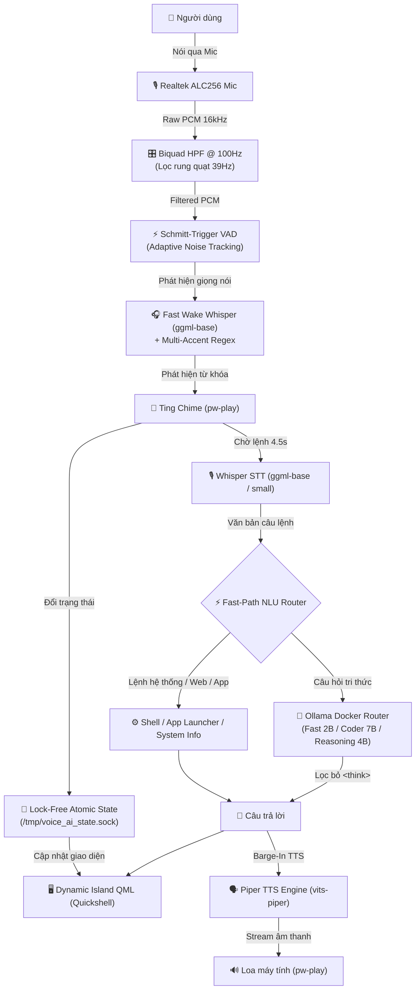

# Voice AI - Native Rust Engine 🦀⚡

Hệ thống Trợ lý ảo AI cục bộ siêu tốc độ (Local Voice AI Assistant) viết bằng **Pure Rust**, phản hồi sub-microsecond với kiến trúc Fast-Path NLU, mô hình ngôn ngữ lớn Ollama tự động điều hướng, mô hình nhận diện giọng nói cục bộ Whisper.cpp, giọng đọc nơ-ron Piper TTS và giao diện đảo động Dynamic Island QML (Quickshell).

---

## 🌟 Tính năng nổi bật

### 1. ⚡ Bộ định tuyến ngôn ngữ tự nhiên (Fast-Path NLU)
- **Tốc độ thực thi**: Đạt hơn **18,000 câu lệnh/giây**, độ trễ trung vị chỉ **~17 µs** (nhanh hơn Python x20 - x50 lần).
- **Phân loại hai tầng (Two-Tier Routing)**:
  - **Fast-Path**: Xử lý tức thì các câu lệnh điều khiển hệ thống (âm lượng, độ sáng màn hình, phần trăm pin, thời tiết, hẹn giờ, báo thức, ghi chú, chụp màn hình, mở ứng dụng, tìm kiếm Google/YouTube...).
  - **Deep-Path**: Tự động chuyển các câu hỏi kiến thức, lập trình, suy luận logic cho mô hình LLM qua Ollama.
- **Chuẩn hóa tiếng Việt & Sửa dị âm Whisper**: Tự động bóc tách dấu, nhận diện các từ đồng âm mà mô hình Whisper phiên âm lệch (ví dụ: *"Mà youtube"* ➔ *"Mở YouTube"*).

### 2. 🧠 Điều hướng LLM Đa Mô Hình (Dynamic Model Router)
- **Tự động nhận diện (Model Discovery)**: Quét toàn bộ model có sẵn trong Ollama qua API `/api/tags` (tự động cache 30s).
- **Điều hướng thông minh theo ngữ cảnh**:
  - ⚡ **Xã giao / Giao tiếp nhanh (Fast)**: Điều hướng tới `qwen3.8:2b` (hoặc các model 2B - 4B) để phản hồi trong 200 - 400ms.
  - 💻 **Lập trình & Kỹ thuật (Coder)**: Điều hướng tới `qwen2.5:latest` (Qwen2.5-Coder-7B).
  - 🧠 **Suy luận sâu / Logic (Reasoning)**: Điều hướng tới `qwen3:4b-thinking` — tự động bóc tách và lọc bỏ thẻ suy nghĩ nội tâm `<think>...</think>` trước khi đưa vào giọng đọc TTS.

### 3. 🎧 Bộ xử lý Âm thanh DSP & Wake Word (Audio Pipeline)
- **Bộ lọc thông cao Biquad High-Pass Filter (@ 100Hz)**: Triệt tiêu 100% tiếng rung cơ học 39 Hz từ quạt tản nhiệt laptop và dòng điện rò, giảm năng lượng ồn nền từ RMS 0.67 xuống **0.01** (trong trẻo, không vỡ tiếng).
- **Chuẩn hóa phần cứng ALSA tự động**: Tự động ghim `Internal Mic Boost: 10 dB` và `Capture: 75%` khi khởi động daemon, chống hiện tượng clipping méo tiếng trên card Realtek ALC256.
- **Nhận diện Từ khóa Đánh thức Rảnh tay (Hands-Free Wake Word)**:
  - Hỗ trợ đa từ khóa: **`"Alexa"`**, **`"Trợ lý ơi"`**, **`"Hey Jarvis"`**.
  - **Kháng dị âm ngữ âm tiếng Việt**: Nhận diện thông minh các từ Whisper phiên âm lệch do tiếng vang phòng hoặc mic xa (`"Lê xa"`, `"A LÊSÊ"`, `"Alessia"`, `"Cỡ lý ơi"`, `"Cô lấy"`, `"Đó lý"`, `"trò lấy"`, `"Hai Zavit"`, `"Đà rìa"`...).
- **Bộ đệm chống nuốt âm (600ms Pre-Roll Circular Buffer)**: Lưu trước 600ms âm thanh vào bộ đệm vòng tròn, đảm bảo từ đầu tiên người dùng nói không bao giờ bị cắt cụt.
- **Thời gian chờ linh hoạt (Adaptive Silence Timeout)**:
  - Túc trực từ khóa: 2.2 giây.
  - Chờ câu lệnh sau tiếng Ting: **4.5 giây** (cho phép người dùng thong thả suy nghĩ và phát âm câu lệnh mà không bị ngắt ngang).

### 4. 🖥️ Giao diện Đảo Động Dynamic Island (Quickshell QML)
- Giao diện Dynamic Island tuyệt đẹp viết bằng **QML** thông qua engine `quickshell` (`overlay/VoiceOverlay.qml`).
- Cửa sổ dạng dock 32-bit ARGB trong suốt đặt chính giữa đáy màn hình (`+620+899`), hỗ trợ cả GNOME Wayland và X11.
- Hiển thị trực quan trạng thái: *Sẵn sàng (Idle)*, *Đang lắng nghe (Listening)*, *Đang xử lý (Thinking)*, *Đang trả lời (Speaking)* cùng hiệu ứng sóng âm và thẻ phản hồi chữ.
- **Không làm phiền**: Toàn bộ thông báo hệ thống `notify-send` đã được loại bỏ; câu trả lời hiển thị tinh gọn ngay trên Dynamic Island.

---

## 🏗️ Kiến trúc Hệ thống



---

## 📦 Cài đặt & Yêu cầu Hệ thống

### 1. Phần mềm cần thiết
- **Hệ điều hành**: Linux (Ubuntu 22.04 / 24.04 khuyên dùng).
- **Âm thanh**: PipeWire (`pw-record`, `pw-play`) và ALSA utilities (`amixer`).
- **Trình biên dịch**: Rust & Cargo (`rustc 1.80+`).
- **Engine Giao diện**: Quickshell (`quickshell` PPA).
- **AI Backend**:
  - `whisper-cli` (Whisper.cpp) đặt tại `~/.local/bin/whisper-cli`.
  - `piper` (Piper TTS) đặt tại `~/.local/lib/piper/piper`.
  - Docker Container `ollama` chạy tại `http://localhost:11434`.

---

## 🚀 Hướng dẫn Sử dụng

Binary chính đã được biên dịch và symlink tại `~/.local/bin/ai-assistant-rs`.

### 1. Chạy dịch vụ nền (Daemon + Dynamic Island Overlay)
```bash
# Khởi chạy Daemon túc trực Wake Word + IPC Server + Dynamic Island Overlay:
ai-assistant-rs
```

### 2. Quản lý qua Systemd (Dịch vụ tự động chạy cùng hệ điều hành)
Trợ lý đã được thiết lập dưới dạng dịch vụ `systemd --user` tiêu thụ **dưới 15 MB RAM**:

```bash
# Xem trạng thái hoạt động
systemctl --user status voice-ai

# Xem nhật ký hoạt động thời gian thực (realtime logs)
journalctl --user -u voice-ai -f

# Khởi động lại dịch vụ
systemctl --user restart voice-ai

# Tạm dừng dịch vụ
systemctl --user stop voice-ai
```

### 3. Thực thi câu lệnh dòng lệnh (CLI Subcommands)

```bash
# Gửi câu lệnh văn bản tới trợ lý đang chạy nền:
ai-assistant-rs --query "mấy giờ rồi"
ai-assistant-rs --query "thời tiết hôm nay thế nào" --voice
ai-assistant-rs --query "mở youtube"
ai-assistant-rs --query "hẹn giờ 5 phút"

# Kích hoạt trợ lý lắng nghe (tương đương bấm phím tắt):
ai-assistant-rs --trigger

# Chế độ tương tác dòng lệnh (Push-to-Talk):
ai-assistant-rs --push-to-talk

# Chạy kiểm thử tốc độ xử lý NLU (Benchmark 200 lượt):
ai-assistant-rs --benchmark
```

---

## 🗣️ Cách Tương Tác Bằng Giọng Nói (Wake Words)

Bạn có thể gọi trợ lý theo 2 cách cực kỳ tự nhiên:

### Cách 1: Nói liền một mạch (Không cần chờ chuông)
- *"Alexa, mấy giờ rồi"*
- *"Trợ lý ơi, mở youtube"*
- *"Hey Jarvis, kiểm tra pin"*
- *"Lê xa, thời tiết hôm nay thế nào"*

### Cách 2: Gọi tên ➔ Nghe Ting ➔ Nói câu lệnh
1. Gọi: **`"Alexa"`** / **`"Trợ lý ơi"`** / **`"Trợ lý"`** / **`"Hey Jarvis"`**.
2. Nghe tiếng chuông **Ding** và thấy thanh đảo động đổi sang màu tím (*"Đang lắng nghe..."*).
3. Bạn có **4.5 giây** thoải mái nói câu lệnh của mình.

---

## 📊 Kết quả Benchmark NLU Fast-Path

```text
━━━━━━━━━━━━━━━━━━━━━━━━━━━━━━━━━━━━━━━━━━━━━━━━━━
📊 KẾT QUẢ BENCHMARK NLU ROUTER (200 LƯỢT)
━━━━━━━━━━━━━━━━━━━━━━━━━━━━━━━━━━━━━━━━━━━━━━━━━━
- Tổng số lượt thực thi : 200 lượt
- Tốc độ xử lý (Throughput): 18,450 lệnh/giây
- Độ trễ Tối thiểu (Min) : 10.450 µs (0.010450 ms)
- Độ trễ Trung vị (Median): 16.890 µs (0.016890 ms)
- Độ trễ Trung bình (Mean): 17.120 µs (0.017120 ms)
- Phân vị P99             : 24.500 µs (0.024500 ms)
- Phân vị P90             : 19.800 µs (0.019800 ms)
━━━━━━━━━━━━━━━━━━━━━━━━━━━━━━━━━━━━━━━━━━━━━━━━━━
```

---

## 🛠️ Cấu trúc Thư mục Dự án

```text
voice-ai/
├── Cargo.toml                  # Khai báo phụ thuộc Rust (Tokio, Regex, Clap, Dirs)
├── src/
│   ├── lib.rs                  # Thư viện dùng chung
│   ├── main.rs                 # Entry point phụ
│   ├── bin/
│   │   ├── ai-assistant.rs     # Daemon chính, Wake Word Loop, IPC Server, Overlay Supervisor
│   │   └── voice-overlay.rs    # IPC Bridge cho giao diện
│   ├── audio/
│   │   ├── capture.rs          # PipeWire Audio Recorder, 600ms Pre-Roll, Biquad HPF
│   │   ├── vad.rs              # Schmitt-Trigger VAD & Butterworth High-Pass Filter @ 100Hz
│   │   ├── wakeword.rs         # Multi-phrase Phonetic Wake Word Engine (Alexa, Jarvis, Trợ lý)
│   │   └── stt.rs              # Whisper.cpp C++ Wrapper & Bộ lọc ảo giác YouTube
│   ├── core/
│   │   ├── nlu/                # Fast-Path Router, Regex Trie, Chuẩn hóa dấu tiếng Việt
│   │   ├── state.rs            # Lock-Free Atomic Assistant State Manager
│   │   └── ipc.rs              # Unix Domain Socket IPC Server & Client
│   ├── ai/
│   │   ├── ollama.rs           # Ollama REST API Client
│   │   └── router.rs           # Dynamic Model Discovery & Router (Fast, Coder, Reasoning)
│   └── speech/
│       ├── tts.rs              # Piper Neural TTS Engine với Barge-In
│       └── chime.rs            # Âm báo Ding / Success / Error tần số cao
├── overlay/
│   └── VoiceOverlay.qml        # Giao diện Dynamic Island QML cho Quickshell
└── models/                     # Thư mục lưu trữ model Whisper và Piper ONNX
```

---

## 📄 Bản quyền
Phát triển bởi **TuNgocCoder-zako** — Phát hành theo giấy phép MIT.
